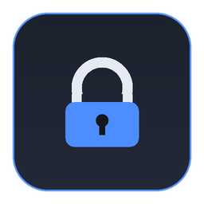
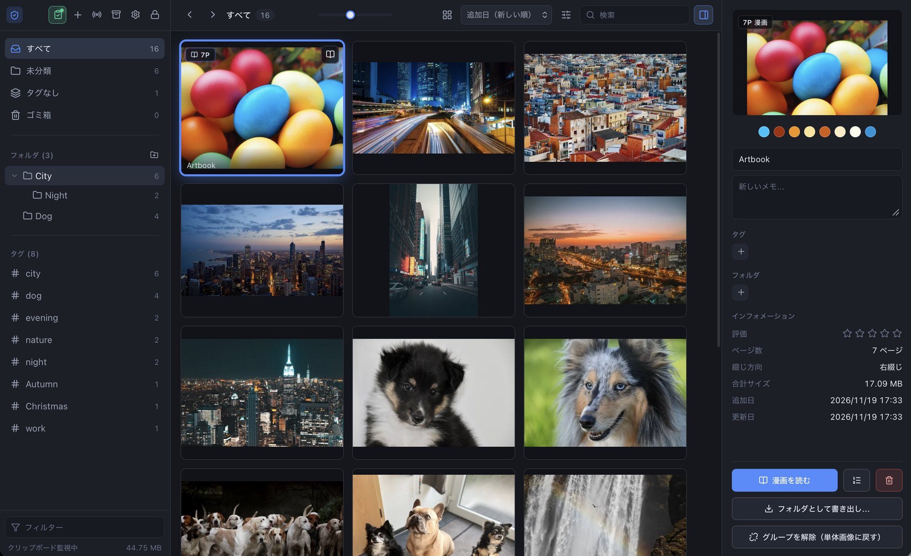
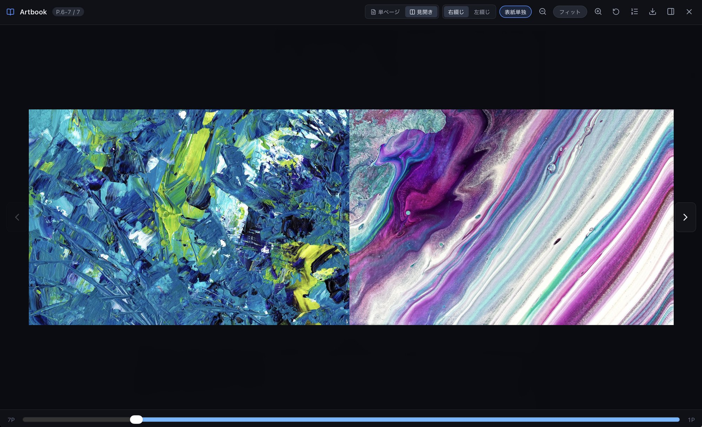
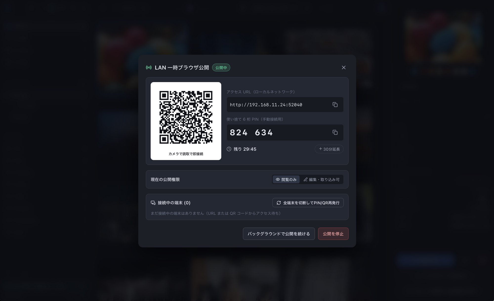
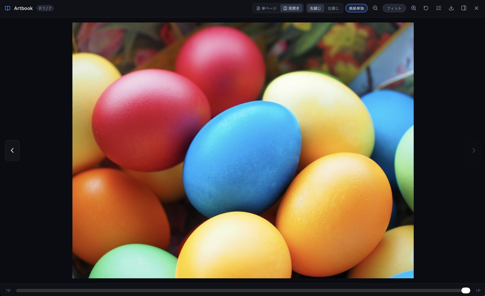
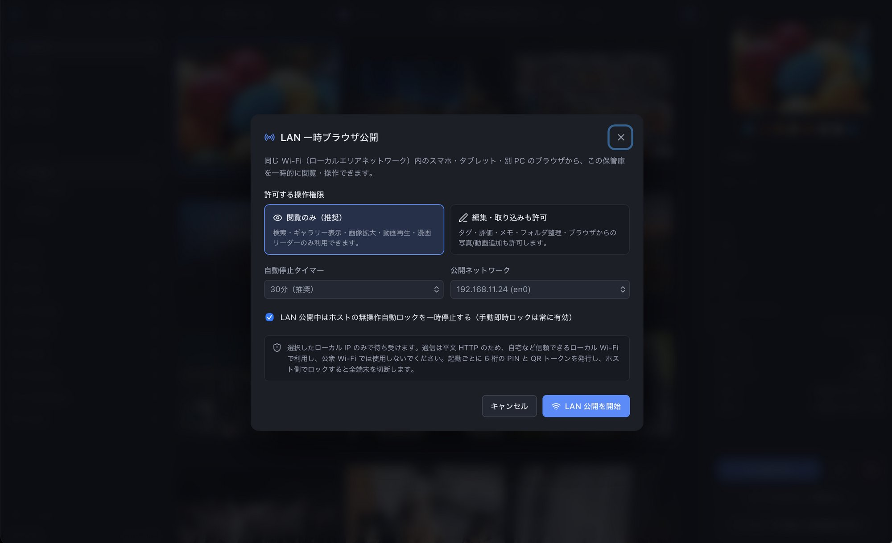
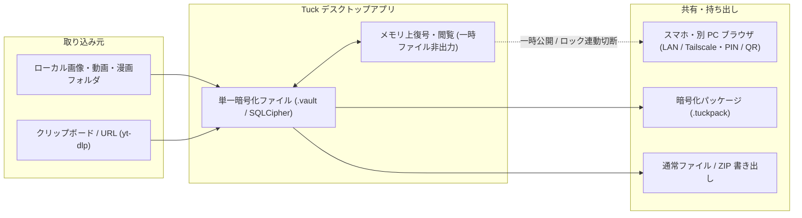

<div align="center">



<h1>Tuck</h1>

<p>
  <strong>完全オフラインで使える単一ファイル暗号化メディア保管庫</strong><br />
  画像・漫画・動画を 1 つの SQLCipher 暗号化ファイル（<code>.vault</code>）にまとめて整理・閲覧できるデスクトップアプリ
</p>

<p>
  <a href="https://github.com/sorami-wanwan/Tuck/releases"></a>
  <a href="https://github.com/sorami-wanwan/Tuck/actions/workflows/ci.yml"></a>
  <a href="LICENSE"></a>
  
  
</p>

<p>
  <a href="#特徴">特徴</a> ·
  <a href="#仕組み">仕組み</a> ·
  <a href="#インストール">インストール</a> ·
  <a href="#ショートカット">ショートカット</a> ·
  <a href="#対応環境">対応環境</a> ·
  <a href="#開発者向け">開発者向け</a>
</p>

<br />



</div>

---

## 特徴

Tauri v2（Rust + React / TypeScript）と SQLCipher で構築されており、ローカル完結のプライバシー保護と軽快な閲覧を両立します。

| カテゴリ | できること |
| --- | --- |
| **単一ファイル暗号化保管庫** | 画像本体・動画チャンク・サムネイル・タグ・フォルダ構造・評価・メモをすべて 1 つの `.vault` ファイルに暗号化保存。閲覧時もメモリ上で復号し、閲覧用の一時ファイルをディスクへ出力しません。 |
| **画像・動画の取り込みと再生** | PNG / JPEG / WebP / GIF / AVIF および MP4 / WebM / MOV に対応。D&D・貼り付け・クリップボード監視・SHA-256 による重複スキップに加え、`yt-dlp` 連携による URL からの動画取り込みも利用できます。 |
| **整理と検索** | 複数に所属できる仮想フォルダ階層、タグ、星評価（1〜5）、メモ、8 色カラーパレット抽出、形式別フィルター、ゴミ箱（復元・完全消去）を備えています。 |
| **漫画グループとリーダー** | フォルダ内の画像を自然順で 1 冊として取り込み、ページ構成や表紙を編集できます。単ページ／見開き、右綴じ／左綴じ、表紙単独表示、拡大縮小と慣性パンに対応します。 |
| **一時 LAN・Tailscale 公開** | 保管庫を開いている間だけ、使い捨ての 6 桁 PIN と QR コードでスマホ・タブレット・別 PC のブラウザへ公開。閲覧専用／編集可のライブ切替、自動停止タイマー、ロックと連動した即時切断に対応します。 |
| **即時ロックと持ち運び** | グローバルショートカットや無操作タイマーで即座にロックし、メモリキャッシュを破棄します。整合性チェック・最適化・バックアップ・暗号化パッケージ（`.tuckpack`）交換・通常ファイル／ZIP 書き出しに対応します。 |

| 漫画リーダー（見開き表示） | 一時 LAN・Tailscale ブラウザ公開 |
| :---: | :---: |
|  |  |

<details>
<summary>その他の画面を見る（表紙単独表示・LAN 公開設定）</summary>

| 漫画リーダー（表紙単独表示） | 一時 LAN 公開の設定画面 |
| :---: | :---: |
|  |  |

</details>

<details>
<summary>機能の詳細仕様を見る（動画チャンク再生・外部コマンド連携・書き出しなど）</summary>

- 大容量動画の暗号化ストリーミング: 大きい動画は 4 MiB ごとのチャンクに分割して暗号化保存し、HTTP Range リクエストによるシーク再生に対応しています。
- URL からの動画取り込み（外部コマンド連携）: 外部コマンドの `yt-dlp` を設定すると、X（GIF 投稿や 1 ポストあたり最大 20 件の複数動画を含む）や TikTok などの URL から動画と出典 URL を取り込めます。ログイン必須の投稿では設定画面でブラウザ Cookie 連携（Arc Browser、Chrome、Safari 等、または `cookies.txt`）を指定できます。HLS（m3u8）や高画質・長尺の動画を取り込むときは `ffmpeg` を併用できます。
- モバイルブラウザ操作: 一時公開中のスマホ・タブレット向けブラウザ画面では、ピンチズーム、スワイプ送り、端タップ操作を利用できます。
- パッケージ交換（`.tuckpack`）: 選択したフォルダ・タグ・項目だけを別パスワードの暗号化パッケージ（`.tuckpack`）として書き出し、別の保管庫へ統合できます（従来の `.kvpack` 取り込みにも対応）。
- 通常ファイルとしての書き出しとブラウザダウンロード: 単体画像・動画、複数選択した項目、漫画グループ（連番フォルダ）、仮想フォルダ階層は、暗号化を解除した元の形式で書き出せます。一時公開中のブラウザからは単体ダウンロードと無圧縮 ZIP の一括ダウンロードができます。実行前には確認ダイアログを表示し、この確認ダイアログの表示は設定画面からオン・オフを切り替えられます。

</details>

---

## 仕組み



> 暗号化境界、一時ブラウザ公開の認証・レート制限、および脅威モデルの詳細は [SECURITY.md](SECURITY.md) を参照してください。

---

## インストール

[GitHub Releases](https://github.com/sorami-wanwan/Tuck/releases) からお使いの OS に合うインストーラまたはパッケージをダウンロードしてください。

| OS | 配布ファイル | 補足 |
| --- | --- | --- |
| macOS (Apple Silicon) | `*_aarch64.dmg` | `アプリケーション` フォルダへコピーして起動 |
| macOS (Intel) | `*_x64.dmg` | `アプリケーション` フォルダへコピーして起動 |
| Windows (x64) | `*_x64-setup.exe` / `*_x64_*.msi` | `.exe` はユーザー領域へインストール可能 |
| Ubuntu 24.04 / 26.04 LTS (x64) | `*_amd64.deb` / `*_amd64.AppImage` | `.deb` を推奨（`sudo apt install ./ファイル名.deb`） |

> [!NOTE]
> 配布バイナリにはコード署名を付与していないため、初回起動時に OS の警告が表示される場合があります。許可手順は下部の折りたたみを確認してください。

<details>
<summary>OS 別の初回起動・許可手順（macOS / Windows / Linux）</summary>

- macOS: 「システム設定 > プライバシーとセキュリティ」から起動を許可するか、ターミナルで以下を実行してください。
  ```bash
  xattr -dr com.apple.quarantine /Applications/Tuck.app
  ```
- Windows: SmartScreen の警告画面が表示された場合は「詳細情報」をクリックし、「実行」を選択してください。
- Linux (Ubuntu): `.deb` の場合は `sudo apt install ./ファイル名.deb` で依存ライブラリごと導入できます。`AppImage` を使う場合は実行権限を付与して起動してください。

</details>

---

## ショートカット

| 場面 | キー | 動作 |
| --- | --- | --- |
| 全般 | <kbd>Cmd</kbd> / <kbd>Ctrl</kbd> + <kbd>V</kbd> | クリップボードの画像や URL を取り込み |
| 全般 | <kbd>Cmd</kbd> / <kbd>Ctrl</kbd> + <kbd>Shift</kbd> + <kbd>L</kbd> | 即時ロック（設定画面で変更可能） |
| 一覧 | <kbd>Enter</kbd> / <kbd>Space</kbd> | 選択中の単体画像や漫画グループを開く |
| ビューア | <kbd>←</kbd> / <kbd>→</kbd> | 前後の項目・ページへ移動 |
| ビューア | <kbd>Space</kbd> | 動画の再生・一時停止 / 漫画ページ送り（<kbd>Shift</kbd> + <kbd>Space</kbd> で戻る） |
| ビューア | <kbd>+</kbd> / <kbd>-</kbd>・<kbd>F</kbd> | 拡大・縮小 / 画面に合わせる |
| ビューア | <kbd>I</kbd> | 詳細パネルを開閉 |
| ビューア | <kbd>0</kbd> 〜 <kbd>5</kbd> | 星評価を設定・解除 |
| 漫画リーダー | <kbd>S</kbd> / <kbd>D</kbd> / <kbd>C</kbd> | 見開き切替 / 綴じ方向切替 / 表紙単独表示切替 |

---

## 対応環境

| プラットフォーム | 配布ビルド | 検証状況 |
| --- | --- | --- |
| macOS (Apple Silicon / Intel) | 対応 | Apple Silicon で日常的に実機検証 |
| Windows (x64) | 対応 | GitHub Actions のビルド・自動テストで確認 |
| Ubuntu 24.04 / 26.04 LTS (x64) | 対応 | GitHub Actions のビルド・自動テストで確認 |

> [!WARNING]
> 一時ブラウザ公開を通常のローカル Wi-Fi で使う場合は **平文 HTTP 通信** となります。自宅など信頼できるローカルネットワーク内だけで利用し、外出先からアクセスする場合は WireGuard で暗号化される Tailscale 経由での利用を推奨します（詳細は [SECURITY.md](SECURITY.md) を参照）。

<details>
<summary>環境別・外部連携の制限事項を見る（Wayland・ブラウザ Cookie・外部コマンド）</summary>

- Wayland 環境（Ubuntu 等）: 純粋な Wayland 環境では X11 ベースのグローバルロックショートカットの登録をスキップして起動を継続します。アプリ内からの手動ロック・無操作ロックおよび `Ctrl + V` の貼り付けによる取り込みは通常通り動作します（バックグラウンドのクリップボード監視は Wayland コンポジタの `data-control` 対応に依存します）。
- ブラウザ Cookie 連携: Arc Browser の直接 Cookie 連携は macOS 限定です。それ以外の場合は他のブラウザ連携や `cookies.txt` の指定を使ってください。macOS で Safari の Cookie を読み込む場合は、「システム設定 > プライバシーとセキュリティ > フルディスクアクセス」で Tuck を許可してください。
- 外部コマンド連携（URL 動画取り込み）: `yt-dlp` や `ffmpeg` は別途インストールが必要です。利用時は対象サイトの利用規約と著作権関連の法令に従ってください。

</details>

---

## 開発者向け

技術スタック: Tauri v2（Rust + React 19 / TypeScript / Vite） · SQLCipher（`rusqlite`） · Axum（一時公開サーバー）

### 前提環境
- [Bun](https://bun.sh/)
- [Rust / Cargo](https://www.rust-lang.org/)（Tauri v2 のビルド環境一式）

<details>
<summary>Windows / Ubuntu でソースからビルドする場合の追加依存</summary>

- Windows: Visual Studio C++ ビルドツールに加えて Strawberry Perl と NASM が必要です。
- Ubuntu (24.04 / 26.04): `libwebkit2gtk-4.1-dev`、`libgtk-3-dev`、`libwayland-dev`、`libayatana-appindicator3-dev`、`librsvg2-dev`、`libssl-dev`、`patchelf` を導入してください（詳細は [.github/workflows/ci.yml](.github/workflows/ci.yml) を参照）。

</details>

### コマンド一覧

```bash
# 依存パッケージをインストール
bun install

# 開発モードでアプリを起動
bun run tauri:dev

# リリースビルド（インストーラと実行バイナリを生成）
bun run tauri:build
```

```bash
# フロントエンドの型チェックとビルド確認
bun run build

# Rust のユニットテストと統合テストを実行
bun run test:rust

# Docker（Ubuntu 26.04）上でビルドと Rust テスト一式を実行
bun run test:docker
```

---

## ドキュメントとライセンス

- 変更履歴: [CHANGELOG.md](CHANGELOG.md)
- セキュリティ設計・脆弱性の報告手順: [SECURITY.md](SECURITY.md)
- コントリビュート方法: [CONTRIBUTING.md](CONTRIBUTING.md)
- ライセンス: [MIT License](LICENSE)
